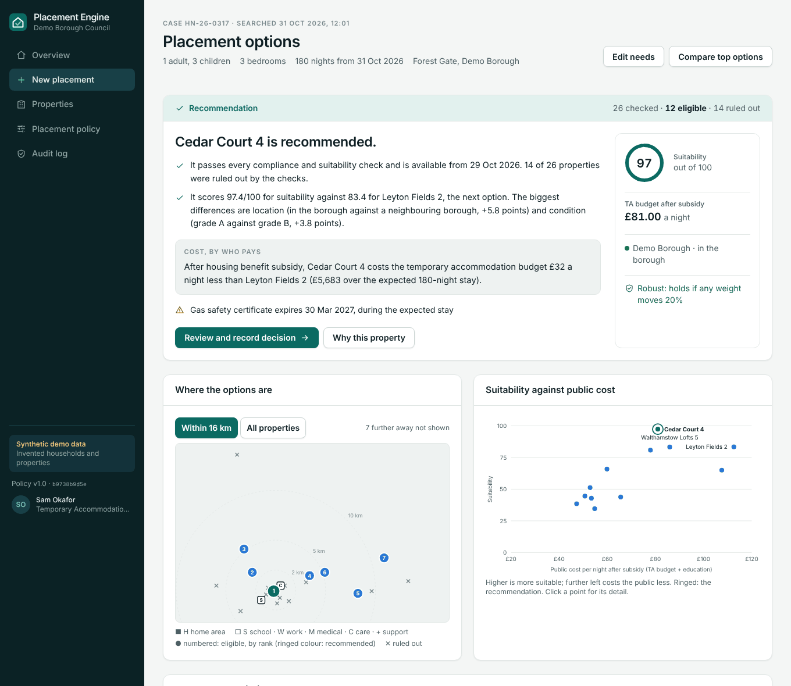
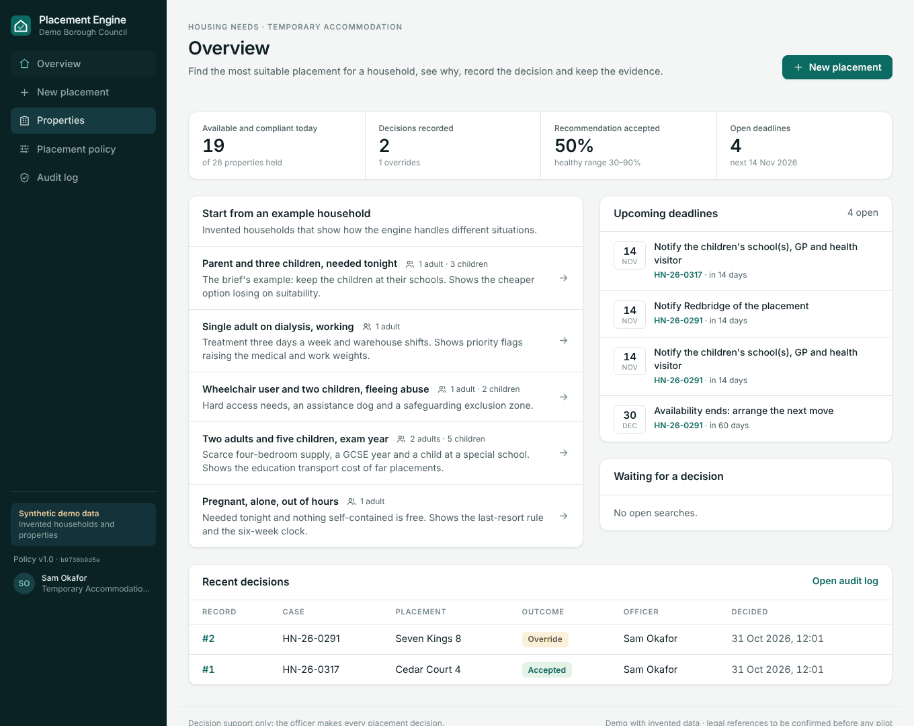
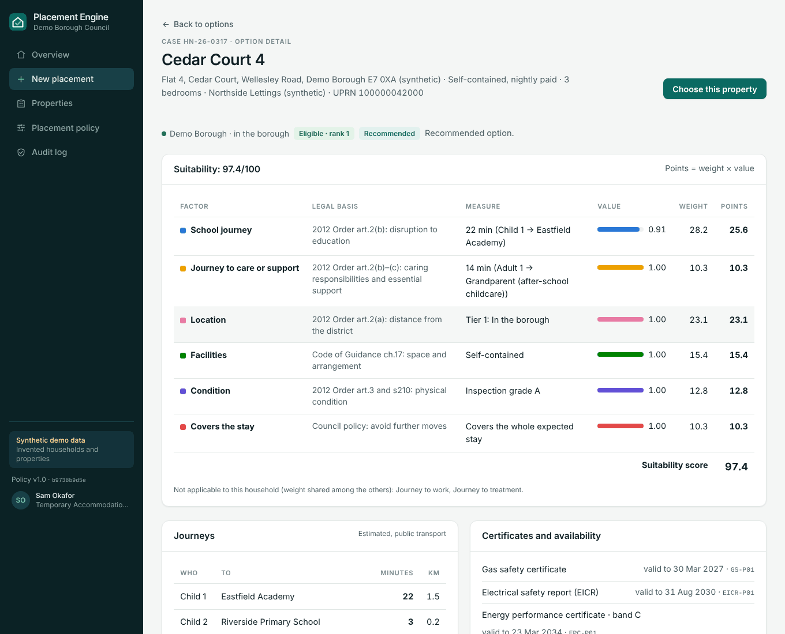
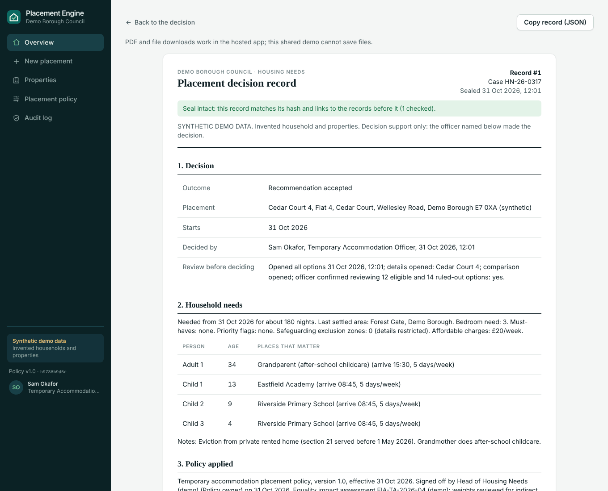
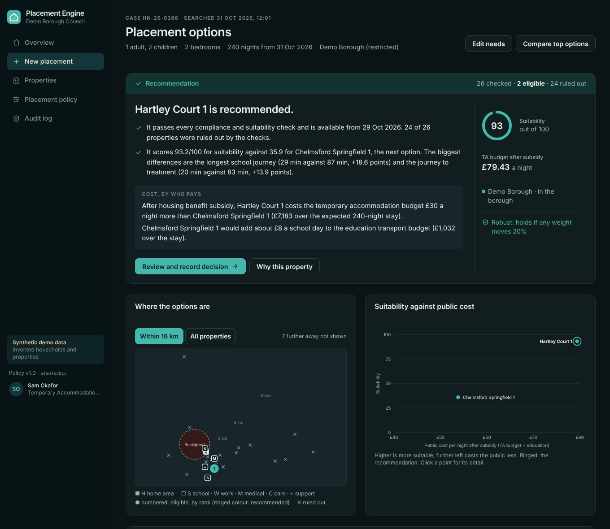

# Placement Engine

**Decision support for council temporary accommodation placements.**

A housing officer enters a homeless household's needs. The engine:

- checks every available property against the legal and policy rules;
- ranks the ones that pass by suitability and net public cost;
- explains its recommendation in plain English.

The officer accepts the recommendation or chooses another option with a reason. Everything they saw and decided is sealed into a tamper-evident record, ready for a review, an Ombudsman complaint or a court.



> **Status: MVP on synthetic data.** Every household, property, supplier and place is invented. Journey times are a labelled estimate and the housing benefit subsidy figures are illustrative. A solicitor should check the legal references before any pilot ([pilot readiness](docs/PILOT-READINESS.md)).

## Why

English councils spent about **£2.9bn** on temporary accommodation in 2025-26. Booking platforms already cover supply, compliance and invoicing; in most of London that platform is Access Adam Housing. What no product does is rank that supply _for this household_, explain the choice and keep the evidence.

The law already asks for that evidence. _Nzolameso v Westminster_ [2015] UKSC 22, _Abdikadir v Ealing_ [2022] EWCA Civ 979 and _R (Imam) v Croydon_ [2023] UKSC 45 expect a council to show four things:

- how it weighed location;
- how it weighed the children's needs;
- that it followed its own placement policy;
- the steps it took to find accommodation.

Since 5 February 2026, the automated-decision rules also require meaningful human review when health or disability data is used. Placement Engine produces that record as a by-product of booking.

## What it does

|                                    |                                                                                                                                                                                                                               |
| ---------------------------------- | ----------------------------------------------------------------------------------------------------------------------------------------------------------------------------------------------------------------------------- |
| **Checks every property**          | Availability, size, access, safety certificates, approved supplier, safeguarding zones, affordability, and the rule against shared rooms for families. Each check cites its legal basis.                                      |
| **Ranks what passes**              | A suitability score from factors the council weights: school, work, treatment and care journeys; location; facilities; condition; whether the property covers the whole stay. Each factor maps to the 2012 Suitability Order. |
| **Shows the real cost**            | The nightly charge minus the housing benefit subsidy the council can reclaim, plus any cost to other budgets (education transport) and to the family. Cost sits beside suitability, never inside it.                          |
| **Explains itself**                | Plain-English reasons, a map, cost against suitability, side-by-side comparison, and a check that the pick still holds if the policy weights move 20% either way. No AI computes or invents anything.                         |
| **Records the officer's decision** | Accept, or override with a reason code and the officer's own words. What they reviewed first is logged.                                                                                                                       |
| **Seals the evidence**             | Canonical JSON snapshot in a SHA-256 hash chain; editing any past record breaks the chain. Audit pack as a page and a PDF.                                                                                                    |
| **Starts the statutory clocks**    | s208 notice to the receiving council, the 6-week limit for families in shared accommodation, s213AA school/GP notification, s202 review window, with draft notices.                                                           |
| **Keeps policy versioned**         | The council's weights and rules are published as signed, hashed versions with an equality note; every decision records the version it used.                                                                                   |

<table>
  <tr>
    <td></td>
    <td></td>
  </tr>
  <tr>
    <td></td>
    <td></td>
  </tr>
</table>

## Try it

```bash
npm install
npm run dev            # http://localhost:5173
```

Start from one of the five example households on the overview:

| Example                                         | What it shows                                                                                                         |
| ----------------------------------------------- | --------------------------------------------------------------------------------------------------------------------- |
| Parent and three children, needed tonight       | The concept brief's example. The cheaper property 51 minutes from school loses on suitability.                        |
| Single adult on dialysis, working               | Priority flags raise the treatment and work weights; the cost tie-break picks between two near-equal options.         |
| Wheelchair user and two children, fleeing abuse | Hard access rules, an assistance dog and a safeguarding exclusion zone. Only two properties pass.                     |
| Two adults and five children, exam year         | Scarce four-bedroom supply. The cheap Luton unit would add about £33k of special-school taxi to the education budget. |
| Pregnant, alone, out of hours                   | Nothing self-contained tonight: shared rooms only as a last resort, with the six-week clock and remedy risk.          |

Then record a decision, open the audit pack, and try **Audit log → Edit record #1 behind the system's back** to see tamper detection.

## Development

| Command               | Does                                                                                                              |
| --------------------- | ----------------------------------------------------------------------------------------------------------------- |
| `npm run dev`         | Local dev server                                                                                                  |
| `npm test`            | Engine, scenario, audit and CSV tests (Vitest)                                                                    |
| `npm run check`       | Typecheck + tests + formatting (what CI runs)                                                                     |
| `npm run build`       | Production build (`dist/`)                                                                                        |
| `npm run build:demo`  | One self-contained HTML file (`dist-demo/index.html`) for a shareable click-through                               |
| `npm run walkthrough` | Clicks through every screen in headless Chromium and saves screenshots to `screenshots/` (run `build:demo` first) |

Stack: React 19, TypeScript, Vite, Tailwind CSS 4, Vitest, `@react-pdf/renderer`. Node 22.

## Documentation

- [How it decides](docs/HOW-IT-DECIDES.md): gates, factors, weights, cost model, recommendation, seal.
- [Architecture](docs/ARCHITECTURE.md): code layout, data flow, the path from MVP to pilot.
- [Pilot readiness](docs/PILOT-READINESS.md): legal, data protection, equality and security checklist before any real household.

The market research, competitor review and commercial plan behind the product are in the ops vault (`bookflo-ops/plans/placement-engine/`).

## Deploy

Vercel with the **Vite** preset: build `npm run build`, output `dist`. There is no server yet, so all data lives in the viewer's browser and each person sees their own demo.

## Not in the MVP, on purpose

Supplier portal or marketplace, reverse placement requests, cross-council supply, invoicing, case management, and live integrations with Adam, Jigsaw, Locata or NEC. Properties come in by CSV.

---

Private repository. All rights reserved by its owners.
